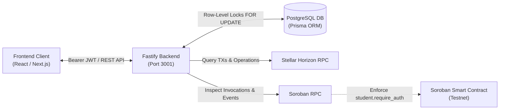

# StellarCampus 🌟

> **Automated On-Chain Verification Platform for Stellar & Soroban Developers**

StellarCampus transitions students, beginner developers, and early-career Web3 builders from passive tutorial consumption to practical, verifiable blockchain engineering tasks. Instead of traditional quizzes, every technical challenge is backed and verified by authoritative Stellar network transactions and Soroban smart contract activity.

---

## 🚀 Live Testnet Deployment

The core challenge smart contract is live and initialized on **Stellar Testnet**:

| Resource | Value / Link |
| :--- | :--- |
| **Network** | Stellar Testnet (`Test SDF Network ; September 2015`) |
| **Deployed Contract ID** | [`CA3P7YT764IMXGP7TRLC64KYONLMCRGUJ23GIU646UKOEFSGPVE7UNFK`](https://lab.stellar.org/r/testnet/contract/CA3P7YT764IMXGP7TRLC64KYONLMCRGUJ23GIU646UKOEFSGPVE7UNFK) |
| **Contract Initialization TX** | [`e0b201e2...`](https://stellar.expert/explorer/testnet/tx/e0b201e20c954298883e0a67a60acda9a1119e1b18e6177de581deb0a02aad16) |
| **Campus Vault / Payment Destination** | [`GAII65YQHVIE4Q2OYG73CRIQZPDN4DJNHN4W6WRUVSJBXEVWPVZ4QKAV`](https://stellar.expert/explorer/testnet/account/GAII65YQHVIE4Q2OYG73CRIQZPDN4DJNHN4W6WRUVSJBXEVWPVZ4QKAV) |
| **Horizon RPC** | `https://horizon-testnet.stellar.org` |
| **Soroban RPC** | `https://soroban-testnet.stellar.org` |

---

## 📚 Essential Documentation

| Document | Purpose |
| :--- | :--- |
| **[Swagger UI](http://localhost:3001/docs)** | **Live Interactive API Playground**: Test endpoints directly from the browser (`/docs` or `/documentation`) with Bearer token authentication and schema models. |
| **[API.md](./API.md)** | **Exhaustive REST API Documentation**: Offline Markdown reference for request/response schemas, status codes, and error bodies for all endpoints. |
| **[HANDSHAKE.md](./HANDSHAKE.md)** | **Frontend Integration Contract**: TypeScript types, Stellar Wallets Kit signing flow, challenge-by-challenge execution instructions, and UI state mappings. |
| **[AGENTS.md](./AGENTS.md)** | **Engineering Mandates & Operating Rules**: Repository constraints, architecture decisions, and git instructions. |

---

## 🛠️ Architecture & Technology Stack



- **Smart Contract**: Rust with `soroban-sdk` (v22), strictly requiring `student.require_auth()`, maintaining persistent completion counters, and emitting indexed Soroban events.
- **Backend API**: Node.js (v22 LTS) + TypeScript + Fastify (v5).
- **Database & ORM**: PostgreSQL with Prisma ORM.
- **Authentication**: Cryptographic wallet ownership validation (Ed25519 signature of a dynamic nonce) issuing a 24-hour Bearer JWT.
- **Concurrency & Anti-Replay Defense**: Native PostgreSQL pessimistic row-level locking (`SELECT ... FOR UPDATE` inside an interactive Prisma `$transaction`) paired with unique database constraints on transaction hashes.

---

## 🎯 Initial Core Challenges

1. **Challenge 1 — Wallet Ownership Verification (`wallet_verify_001`)**: Proves control of the student's Stellar private key via Ed25519 challenge-response. Automatically credits completion upon authentication.
2. **Challenge 2 — Fund a Stellar Testnet Account (`fund_account_002`)**: Connects to Friendbot and verifies that the student account has been created with $\ge 1$ XLM balance.
3. **Challenge 3 — Execute an XLM Payment (`payment_xlm_003`)**: Transmits 2.0 XLM to the Campus Vault matching the student's assigned dynamic memo reference (e.g. `SC-491029`).
4. **Challenge 4 — Transfer a Supported Stellar Asset (`asset_transfer_004`)**: Establishes a trustline for the `CAMPUS` test token, claims test tokens from the platform faucet (`/api/challenges/asset_transfer_004/claim-tokens`), and transfers 10.0 CAMPUS tokens to the vault with the assigned dynamic memo.
5. **Challenge 5 — Interact with a Soroban Smart Contract (`soroban_contract_005`)**: Invokes `complete_challenge` on the deployed Soroban contract on Testnet with student wallet authorization.

---

## 💻 Local Development Setup

### Prerequisites
- **Node.js**: v22+ & npm v10+
- **Rust & Cargo**: v1.84+ with target `wasm32-unknown-unknown`
- **PostgreSQL**: v15+ running on `localhost:5432`
- **Stellar CLI**: `brew install stellar-cli`

### 1. Database Setup
Ensure PostgreSQL is running locally, then initialize the database:
```bash
createdb stellarcampus
```

### 2. Backend Setup
```bash
cd backend

# Copy environment variables
cp .env.example .env

# Install dependencies
npm install

# Generate Prisma Client & push schema
npx prisma generate
npx prisma db push

# Seed initial 5 challenges
npm run prisma:seed

# Run dev server (http://localhost:3001)
npm run dev
```

### 3. Running Backend Automated Tests
```bash
cd backend
npm test
```
*Executes all 10 Vitest tests covering Ed25519 cryptographic authentication, Horizon payment verification rules, and row-level locking concurrency controls.*

### 4. Running Smart Contract Tests & Building WASM
```bash
cd contracts/challenge-contract

# Run unit tests
cargo test

# Build optimized release WASM
cargo build --target wasm32-unknown-unknown --release
```

---

## 👥 Team & Stakeholder Summary

- **Backend & Smart Contract Lead**: Complete verification engine, database schema, and Soroban contract deployed to Stellar Testnet.
- **Frontend Engineers**: Refer directly to [HANDSHAKE.md](./HANDSHAKE.md) for endpoint contracts, TypeScript interfaces, and Screen 9 status handling.
- **Stakeholders & Product Managers**: Refer to [API.md](./API.md) for all supported capabilities and [API metrics](./API.md#4-admin-monitoring) for platform monitoring.
